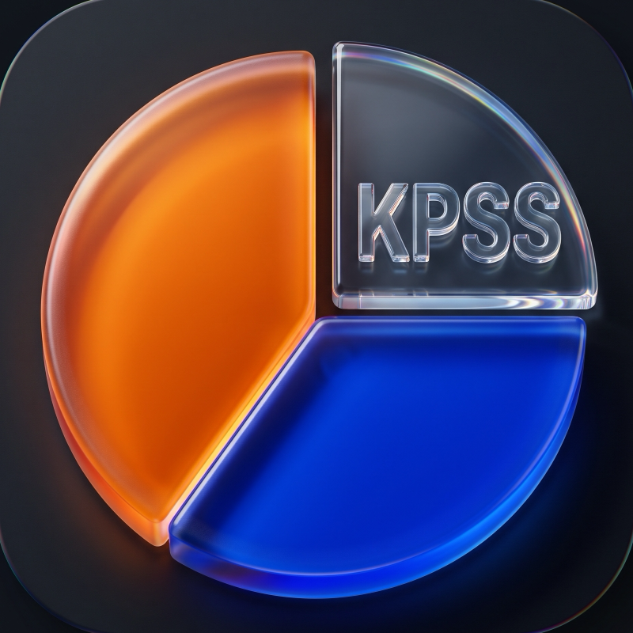
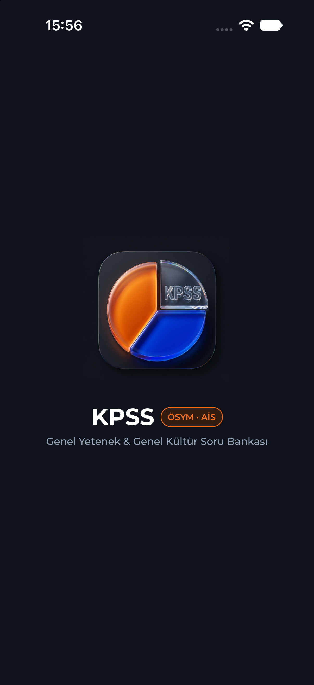
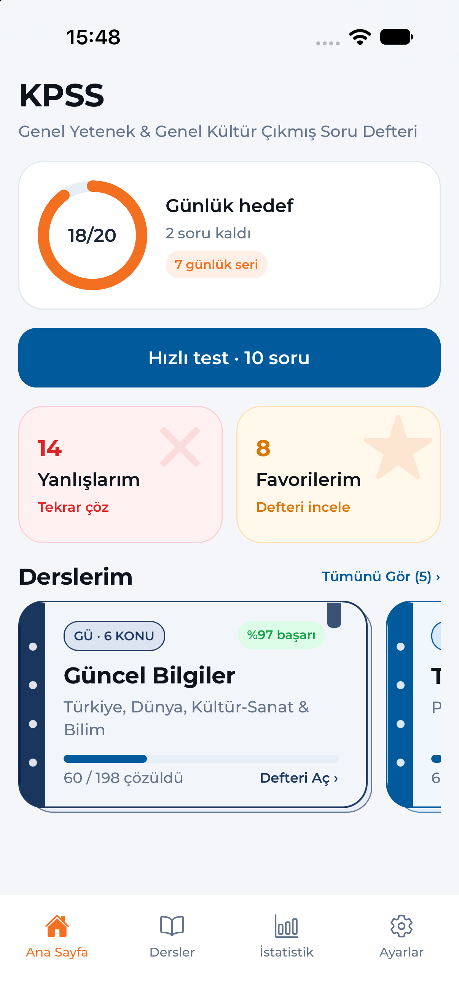
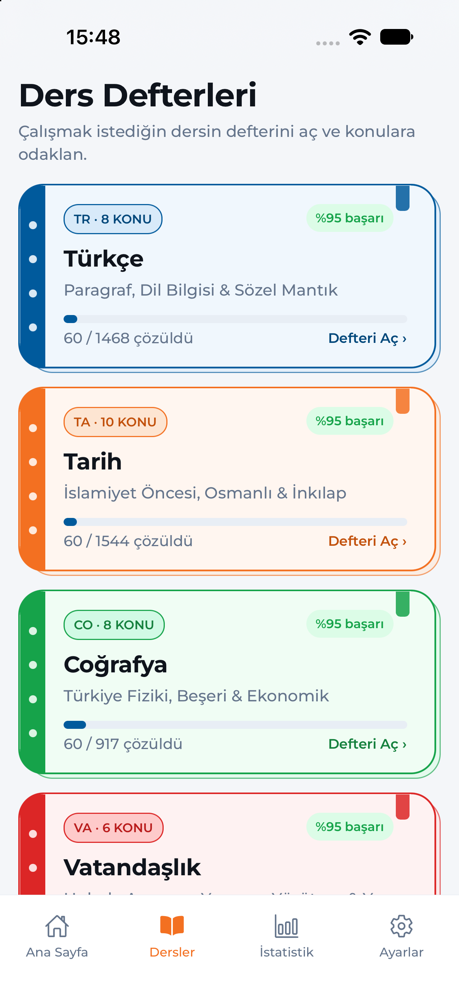
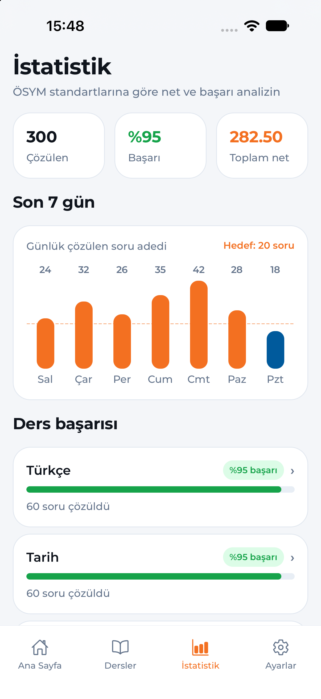
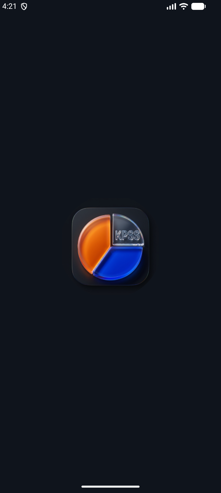
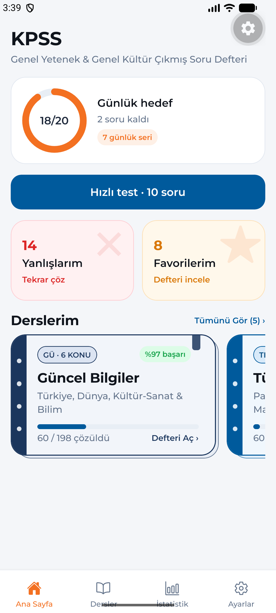
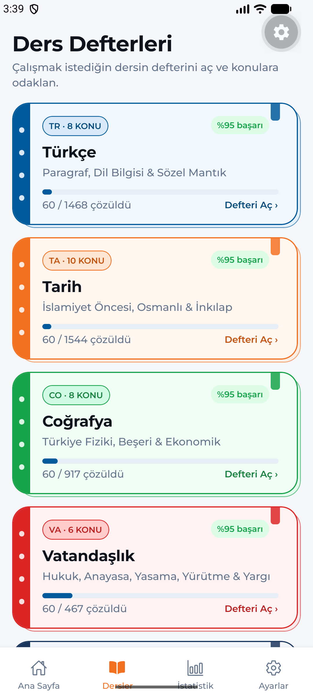
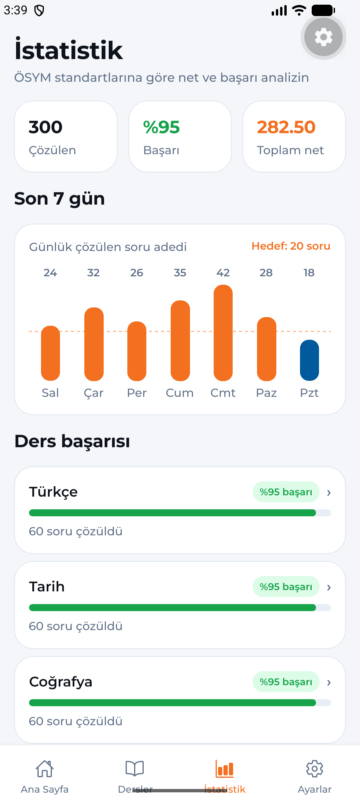

  

  # KPSS Hazırlık: Soru Defteri
  **Genel Yetenek & Genel Kültür Çıkmış Soru ve Konu Testleri**

  
  
  

---

## Hızlı Bağlantılar (GitHub Pages)

| Sayfa | Bağlantı | Açıklama |
| :--- | :--- | :--- |
| **Tanıtım & Destek Sayfası** | [alierensevinc.github.io/KPSS-Mobil-App](https://alierensevinc.github.io/KPSS-Mobil-App/) | Uygulama tanıtımı, etkileşimli ders defterleri ve örnek soru çözümü |
| **Gizlilik Politikası (Privacy Policy)** | [privacy-policy.html](https://alierensevinc.github.io/KPSS-Mobil-App/privacy-policy.html) | App Store & Google Play mağaza gizlilik beyanı |
| **Kullanım Koşulları (Terms & Conditions)** | [terms-and-conditions.html](https://alierensevinc.github.io/KPSS-Mobil-App/terms-and-conditions.html) | Kullanım koşulları ve yasal sorumluluk beyanı |
| **Authorized Digital Sellers (`app-ads.txt`)** | [app-ads.txt](https://alierensevinc.github.io/KPSS-Mobil-App/app-ads.txt) | AdMob / Google yayıncı doğrulama dosyası |

---

## Uygulama Hakkında

**KPSS Hazırlık: Soru Defteri** (`com.sevincaeren.kpssmobil`), **ÖSYM & AİS** kurumsal renk paletinden ve öğrencilerin çalışma masasında kullandığı **renkli spiralli ders defterlerinden** ilham alan, tamamen **çevrimdışı (offline-first)** çalışan bir KPSS Genel Yetenek – Genel Kültür soru bankası uygulamasıdır.

- **4.594 Doğrulanmış Soru:** 5 ders ve 38 alt konuda tamamı 5 şıklı ve detaylı çözüm açıklamalı soru havuzu.
- **10 Soruluk Hızlı Mini Testler:** Genel karışık, ders bazlı ve konu bazlı mini testlerle çözülmemiş sorular öncelikli çalışma akışı.
- **Akıllı Yanlışlarım Havuzu:** Yanlış çözülen sorular otomatik birikir; tekrar testinde doğru çözüldüğünde listeden düşer.
- **Favori Defterim (İnceleme Modu):** Favoriye alınan sorular, doğru cevabı yeşil vurgulu ve çözüm açıklaması açık şekilde ders notu gibi incelenir.
- **ÖSYM Standartlarında Net & İstatistik:** Gerçek net hesabı (`Doğru − Yanlış / 4`), günlük soru hedefi halkası ve 7 günlük aktivite grafiği.

---

## Ders Defterleri & Soru Dağılımı

| Ders | Kod | Konu Sayısı | Soru Sayısı | Defter Sırt Rengi |
| :--- | :---: | :---: | ---: | :--- |
| **Tarih** | `TA` | 10 | 1.544 | ÖSYM Turuncusu (`#F37021`) |
| **Türkçe** | `TR` | 8 | 1.468 | AİS Mavisi (`#005A9C`) |
| **Coğrafya** | `CO` | 8 | 917 | Zümrüt Yeşili (`#16A34A`) |
| **Vatandaşlık** | `VA` | 6 | 467 | Mercan Kırmızısı (`#DC2626`) |
| **Güncel Bilgiler** | `GÜ` | 6 | 198 | Kurumsal Lacivert (`#1B365D`) |
| **Toplam** | | **38** | **4.594** | |

---

## Ekran Görüntüleri

### iOS (iPhone)

  
  
  
  

### Android

  
  
  
  

---

## Yasal Bildirim & ÖSYM Bağımsızlık Beyanı

> **Bağımsızlık Beyanı:** Bu uygulama Ölçme, Seçme ve Yerleştirme Merkezi (**ÖSYM**) veya herhangi bir resmi devlet kurumu ile bağlantılı değildir, resmi kurumları temsil etmez. KPSS adayları için bağımsız bir sınava hazırlık ve çalışma aracı olarak geliştirilmiştir.

- **İletişim & Destek:** [sevinc.aeren@gmail.com](mailto:sevinc.aeren@gmail.com)
- **Lisans:** [MIT License](./LICENSE) — Copyright © 2026 A. Eren Sevinc
